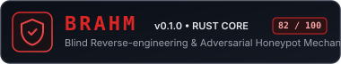

<div align="center">



# BRAHM — Blind Reverse-engineering & Adversarial Honeypot Mechanism

**Deterministic Pure-Rust Anti-Reverse-Engineering CLI, Code Intelligence Engine & Controlled Deception Telemetry Framework**

-DC2626?style=for-the-badge)
-111827?style=for-the-badge)
-EF4444?style=for-the-badge)


</div>

---

## 1. Executive Summary

**BRAHM** is a pure-Rust, deterministic cybersecurity CLI and software-protection engine that loads any user software repository, extracts its structural and cryptographic baseline read-only, generates non-secret synthetic decoy overlays and canary anchors, provisions an isolated inspection workspace for external reviewers or AI coding assistants, and records high-signal access and integrity telemetry into SQLite.

Per owner design directives, BRAHM is built strictly as a **pure CLI / Rust anti-reverse-engineering engine** with no web frontend GUI (`dashboard/` omitted) and **zero runtime AI/LLM dependencies**. Every analysis pass, AST parse, decoy check, sandbox guard, integrity verification, and classifier rule executes deterministically on your local machine.

---

## 2. Core Problem & Threat Model

When organizations share source repositories with external contractors, third-party security auditors, or autonomous coding assistants:
1. Unprotected code exposes complete API surfaces, business workflows, database schemas, and implementation flaws immediately without visibility or audit trail.
2. Injecting naive decoys directly into genuine source directories risks breaking builds, polluting version control, or accidentally leaking credentials.
3. Relying on external AI services to generate obfuscations compromises confidentiality and produces non-reproducible output.

BRAHM addresses this threat model by separating the **genuine production repository** (never mutated, sealed with BLAKE3) from an **isolated deceptive inspection workspace** (`ControlledInspection` / `ResearchMode`) instrumented with canary markers, policy rules, and verifiable baseline integrity checks.

---

## 3. System Architecture (Stages 01–07)

```mermaid
flowchart LR
    U["User Repository (Read-Only Source)"] -->|"brahm apply &lt;path&gt;"| S12["Stages 01-02: Scanner, BLAKE3 &amp; Tree-sitter Architecture"]
    S12 -->|"Architecture + Baseline Seal"| S3["Stage 03: Architecture-Aware Decoy &amp; Canary Engine"]
    S12 -->|"Immutable Baseline JSON"| S4["Stage 04: RepositoryMirror + DeceptionPolicy"]
    S3 -->|"Isolated Synthetic Layer"| S4
    S4 -->|"Controlled Workspace Mirror"| WS["External Reviewer / Coding Agent Sandbox"]
    WS -->|"brahm agent run / Telemetry"| S6["Stage 06: SQLite EventStore, CanaryDetector &amp; Classifier"]
    U -->|"brahm integrity check"| S6
    S6 -->|"JSON / Markdown Reports &amp; Optional Localhost API"| Out["Audit Artifacts"]
```



---

## 4. Capabilities Across Stages

| Stage | Subsystem | Verified Capabilities |
| :--- | :--- | :--- |
| **Stage 01** | Repository Analyzer | Recursive filesystem scanner, 25+ language detection, framework/manifest checks, sensitive file protection (`.env`, `.pem`, `id_rsa`), BLAKE3 hashing, JSON/MD/terminal reports. |
| **Stage 02** | Code Intelligence | Tree-sitter `0.25` AST parsing (Rust, TypeScript/JavaScript, Python, Go, Java, C/C++), BLAKE3 symbol indexing, dependency/cycle detection, REST routes (`Express` incl. middleware, Next.js, FastAPI/Flask, Axum, Actix, Gin, Spring), SQL DDL schemas, `petgraph` DAG + blast radius. |
| **Stage 03** | Decoy Generation Engine | Architecture-matched non-executing synthetic docs/configs/schemas/TS bridges/canary tokens (`BRAHM-CANARY-*`), validator blocking real secrets & manifest overwrites, ownership-verified cleanup. |
| **Stage 04** | Repository Deception Engine | `GenuineLayer` / `SyntheticLayer` / `InspectionLayer` separation, automatic `.env`/secret stripping during workspace mirroring, deterministic deception policies (`Conservative`, `Standard`, `Research`), sandbox path-traversal defense. |
| **Stage 05** | Integration & Apply CLI | **One-command `brahm apply <path>`** (`brahm protect`), local & credential-safe GitHub cloning, `ProtectionInstaller` with preview plans (`--dry-run`) and explicit approval gates, safe rollback. |
| **Stage 06** | Monitoring & Intelligence | Embedded SQLite telemetry (`brahm_monitoring.db`), 5s deduplicating `CanaryDetector`, chronological `TimelineCorrelator`, deterministic `RuleBasedClassifier` with explicit attribution uncertainty disclaimers, baseline diff `IntegrityMonitor`, optional authenticated localhost Axum API. |
| **Stage 07** | Validation & Benchmark Suite | Full codebase audit (`ISSUE-001`–`009`), 20-step E2E CLI validation, 13 security failure gates, controlled A/B experiment on `demo/brahm-commerce-demo`, evidence-based 100-point rating engine. |

---

## 5. Technology Stack & Pure-Deterministic Design

- **Language & Runtime:** Rust (Edition 2021, MSRV `1.80`, zero `python`/Node runtime inside BRAHM core)
- **Parsing & Graphs:** `tree-sitter 0.25`, `petgraph 0.8.3`
- **Cryptography & Storage:** `blake3`, bundled `rusqlite 0.40` (SQLite WAL), `uuid`, `sha2`
- **CLI & Local API:** `clap 4.5` (`derive`), `tokio`, `axum 0.8.9`, `serde` / `serde_json` / `toml`

---

## 6. Installation & Build Guide

### Prerequisites
- **Rust toolchain** (`>= 1.80`, `cargo` and `rustc`)
- **Node.js `>= 22.5` + npm** *(only required if re-running the external demo target test suite in `demo/brahm-commerce-demo`)*

### Build & Verify from Source

```powershell
git clone https://github.com/DDharm007/brahm.git
cd brahm

cargo fmt --check
cargo clippy --all-targets --all-features -- -D warnings
cargo test
cargo build --release
```

Compiled CLI binary output: `target/release/brahm.exe` (Windows) or `target/release/brahm` (Linux/macOS).

---

## 7. Quick Start: Load Any Project & Apply BRAHM Protection

Point `brahm apply` (alias `brahm protect`) directly at any local software repository. BRAHM leaves the original repository 100% untouched while generating a baseline seal, architecture map, synthetic decoy layer, active inspection workspace, and SQLite telemetry database inside `--state-dir`:

```powershell
# 1. Preview protection actions without modifying disk
./target/release/brahm.exe apply C:\path\to\your-project --dry-run

# 2. Load the project and apply controlled anti-RE protection in one command
./target/release/brahm.exe apply C:\path\to\your-project --state-dir .\.brahm_state --profile controlled-inspection --json

#    For maximum research telemetry overlays (11 synthetic/canary artifacts):
./target/release/brahm.exe apply C:\path\to\your-project --state-dir .\.brahm_state --profile research-mode

# 3. Verify original project & staged decoys against sealed BLAKE3 digests
./target/release/brahm.exe integrity check --state-dir .\.brahm_state

# 4. Run sandboxed inspection telemetry & generate intelligence reports
./target/release/brahm.exe agent run <SESSION_ID> --state-dir .\.brahm_state --paths canary/BRAHM_CANARY_ANCHOR.md package.json
./target/release/brahm.exe reports generate --state-dir .\.brahm_state

# 5. Cleanly roll back all BRAHM-owned decoys & inspection workspaces when done
./target/release/brahm.exe protection rollback --state-dir .\.brahm_state
```

---

## 8. CLI Command Reference

| Command | Purpose |
| :--- | :--- |
| `brahm apply <REPO>` *(alias `protect`)* | Single-command load, Stage 02 map, decoy stage, mirror creation, SQLite init & integrity verify (`--dry-run`, `--profile`, `--state-dir`, `--json`). |
| `brahm scan <REPO>` / `brahm arch <REPO>` | Run read-only Stage 01 scan or deep Stage 02 AST/symbol/dependency architecture reports (`terminal`, `json`, `markdown`, `all`). |
| `brahm connect local \| github` | Onboard a local folder or authorized clean GitHub HTTPS/SSH repo (rejects embedded URL secrets). |
| `brahm protection plan \| validate \| install \| status \| rollback` | Explicit-approval protection lifecycle and ownership-gated rollback. |
| `brahm decoy generate \| list \| inspect \| validate \| remove` | Generate, inspect, verify BLAKE3 integrity, or prune synthetic artifacts cleanly. |
| `brahm deception prepare \| policy \| session \| cleanup` | Prepare isolated workspace mirrors, list/validate policies, stop/clean sessions. |
| `brahm agent run <SESSION_ID>` | Drive controlled `LocalTestAgentAdapter` over sandbox paths and persist telemetry into SQLite. |
| `brahm events list \| inspect` & `brahm sessions timeline <SID>` | Query SQLite security events and ordered session timelines. |
| `brahm integrity check` | Compare live genuine source + decoys against sealed `BRAHM_BASELINE.json`. |
| `brahm reports generate` | Export all 5 Stage 06 JSON + Markdown intelligence deliverables. |
| `brahm monitor status \| start \| stop` | Inspect SQLite stats or launch localhost-bound authenticated Axum API. |

Full flag specifications are available in [`docs/CLI_REFERENCE.md`](docs/CLI_REFERENCE.md).

---

## 9. Demonstration Target & Controlled Experiment Summary

To validate BRAHM empirically without making assumptions or inspecting unauthorized repositories, we constructed a realistic **Node.js `v24` + TypeScript + Express + SQLite** e-commerce API target ([`demo/brahm-commerce-demo/`](demo/brahm-commerce-demo/)) with:
- **20 REST API endpoints** (`health`, `auth`, `products`, `cart`, `orders`, `payments`, `admin`)
- **9 relational SQLite tables** (`db/schema.sql`) and seed category migration
- `scryptSync` + HMAC-SHA256 Bearer auth, RBAC, HMAC-SHA256 webhooks, `BEGIN IMMEDIATE` atomic checkout transactions, and **3/3 passing integration tests** (`npx tsc && node --test`)

Two isolated read-only inspecting agents received identical blind reverse-engineering prompts:
- **Control:** Unprotected workspace copy ([`experiments/results/unprotected/`](experiments/results/unprotected/metrics.json), `37` files).
- **Protected:** BRAHM `research-mode` inspection workspace (`sess_bd85ce628669`, [`experiments/results/protected/`](experiments/results/protected/metrics.json), `37` genuine + `11` synthetic/canary = `48` files), followed by deterministic telemetry replay via `brahm agent run`.

---

## 10. Experimental Results Comparison

| Metric | Unprotected Control | BRAHM Protected (`research-mode`) | Measured Delta / Effect |
| :--- | ---: | ---: | :--- |
| Workspace Files Inspected | 37 / 37 | **48 / 48** (`37` real + `11` decoy) | **`+29.73%` extra file reads** |
| Elapsed Agent Duration | 155 s | **211 s** | **`+36.13%` inspection overhead** |
| Genuine Route / Table / Service Recall | 20/20 · 9/9 · 6/6 (100%) | 20/20 · 9/9 · 6/6 (100%) | Genuine semantics preserved when code readable |
| Synthetic Overlays Adopted as Genuine | 0 | 0 (`11/11` identified via markers/imports) | Audit-safe `.decoy.` markers spotted cleanly |
| **Registered Canaries Triggered** | 0 | **11 / 11 (100.0%)** | Full deterministic canary capture |
| **SQLite Monitoring Events Logged** | 0 | **23** (`High` rule `R01_REPEATED_CANARY_ACCESS`) | Complete forensic session timeline |
| **Genuine Repo Contamination** | N/A | **0** (`baseline_matches: true`) | Zero production mutation |
| Token Usage | Not exposed by runtime | Not exposed by runtime | Unreported rather than estimated |

See full comparative analysis and Mermaid diagrams in [`reports/BRAHM_FINAL_EXPERIMENT_REPORT.md`](reports/BRAHM_FINAL_EXPERIMENT_REPORT.md).

---

## 11. Evidence-Based BRAHM Rating: **82.0 / 100 (`Strong`)**

| Dimension | Weight | Score | Summary Evidence |
| :--- | ---: | ---: | :--- |
| Architecture Discovery Accuracy | 15.0 | **14.0** | `100%` route/SQL/symbol extraction in `25 ms` on demo (`20/20` routes, `10/10` models). |
| Decoy Realism & Structural Fit | 15.0 | **9.0** | Zero build breakage or secret leakage; docked `-6.0` for `.decoy.`/`CANARY` markers identifiable in white-box review. |
| RE Confusion & Effort Amplification | 15.0 | **7.0** | Measurable `+29.73%` files / `+36.13%` time overhead without preventing genuine route recovery under full white-box read. |
| Canary Detection & Telemetry | 15.0 | **14.0** | `11/11` canary triggers (`23` events, `R01` alert, traversal block); mediated workspace boundary (`-1.0`). |
| Production Safety & Integrity | 15.0 | **15.0** | Zero repo contamination, cryptographic tamper alerts (`E2E-18`), symlink/secret guards, ownership rollback. |
| Operational Usability & CLI | 15.0 | **13.0** | Single-command `brahm apply`, `20/20` E2E + `13/13` failure checks, strict localhost API (`-2.0` CLI defaults & UNC paths). |
| Deterministic Execution & Tests | 10.0 | **10.0** | Pure Rust (`0` AI dependencies), `134/134` tests passing, `0` clippy warnings. |
| **Total** | **100.0** | **82.0** | **Band: `Strong` (`75–89`)** — see [`reports/BRAHM_RATING.md`](reports/BRAHM_RATING.md) |

---

## 12. Optional Localhost Telemetry HTTP API

No browser GUI frontend is bundled; automated tooling can optionally inspect JSON telemetry over localhost (`127.0.0.1`) using a Bearer token (`>= 16` chars):

```powershell
$env:BRAHM_MONITOR_TOKEN = "your-local-32-char-operator-token"
./target/release/brahm.exe monitor start --state-dir .\.brahm_state --bind 127.0.0.1:8787
```

Authenticated endpoints: `GET /api/v1/{repositories,architecture,deception,events,sessions,decoys,integrity,reports,rating,experiment}` (plus unauthenticated `GET /api/v1/health`). Non-loopback binds require explicit `--allow-remote`, unauthenticated access returns `401 Unauthorized`, and sliding-window rate limiting enforces `429 Too Many Requests`.

---

## 13. Coding Agent / AI Inspection Integration Instructions

Add the block below to your external assistant configuration (`AGENTS.md`, `CLAUDE.md`, or CI reviewer guidelines) so external coding agents **never read raw unmonitored production directories** and always inspect through BRAHM's controlled workspace:

```markdown
## Repository Inspection Boundary (BRAHM Protected Workflow)
1. Never read or write the raw genuine repository root directly during external review.
2. Load inspection targets strictly via:
   `brahm apply <PROJECT_PATH> --state-dir .brahm_state --profile controlled-inspection --json`
3. Restrict agent file reads exclusively to the returned `inspection_workspace` directory.
4. Keep `.brahm_state/` excluded from production builds, deployments, and commits.
5. After review completes, run `brahm integrity check --state-dir .brahm_state` and
   `brahm protection rollback --state-dir .brahm_state`.
```

---

## 14. Security Guarantees & Honest Limitations

### Verified Security Guarantees
- **Read-Only Analysis:** `brahm scan` and `brahm arch` never modify target repository files.
- **No Production Decoy Leakage:** Decoys and mirrors live strictly under `--state-dir` (`ProductionIntegrityGuard`, `E2E-20`).
- **Sensitive Secret Protection:** `.env`, `.pem`, `.key`, `id_rsa`, `credentials.json` are excluded from BLAKE3 hashing, AST parsing, and workspace mirrors (`FAIL-09`, `test_03_secret_protection_stage02`).
- **Symlink & Traversal Containment:** Unfollowed symlinks skipped (`ISSUE-002`); sandbox `../` escapes blocked and logged (`FAIL-09`).

### Honest Limitations
- BRAHM **does not claim complete prevention of reverse engineering** against white-box analysts or LLM coding agents holding full read access to plaintext source code.
- Explicit `.decoy.` / `BRAHM_CANARY_*` conventions keep developer risk zero but allow semantic analysts to identify overlays.
- Canary hits confirm artifact access inside the instrumented boundary and **do not prove human vs. AI model identity**.

---

## 15. Repository Structure

```text
brahm/
├── src/                        # Pure Rust engine & CLI (`cli`, `scanner`, `parser`, `deception`, `integration`, `monitoring`)
├── tests/                      # 16 integration suites + unit tests (134/134 passing)
├── demo/brahm-commerce-demo/   # Realistic Node.js/TypeScript/Express/SQLite target API (3/3 integration tests)
├── experiments/                # Controlled A/B experiment workspaces, private ground truth & raw results
├── reports/                    # Issue Register, E2E Validation, Rating, Scorecard & Final Experiment Report
├── scripts/                    # Clean-environment reproduction script (`reproduce_experiment.ps1`)
└── docs/                       # Architecture, CLI Reference, Security Model & Stage 07 Audit
```

---

## 16. Testing, Verification & Reproducibility

- **Rust Unit & Integration Suite:** `134 / 134` passed (`cargo test`, 0 ignored, 0 failed)
- **Lint & Format:** `cargo fmt --check` clean · `cargo clippy --all-targets --all-features -- -D warnings` (0 warnings)
- **CLI End-to-End & Security Gates:** `20 / 20` E2E + `13 / 13` failure paths verified ([`reports/BRAHM_END_TO_END_VALIDATION.md`](reports/BRAHM_END_TO_END_VALIDATION.md))
- **Clean Reproduction Script:**
  ```powershell
  powershell -ExecutionPolicy Bypass -File .\scripts\reproduce_experiment.ps1
  ```

---

## 17. Troubleshooting

- **Missing baseline on `integrity check`:** Run `brahm apply <REPO>` or `brahm connect local <REPO>` first so `BRAHM_BASELINE.json` is sealed inside `--state-dir`.
- **Piping `--json` output cleanly:** Diagnostic `INFO` logs emit to `stderr` while `--json` outputs emit purely to `stdout`.
- **`monitor start` refuses startup:** Set `$env:BRAHM_MONITOR_TOKEN` to at least 16 characters; pass `--allow-remote` only when binding outside `127.0.0.1` / `localhost`.

---

## 18. License & Ethical Use

BRAHM is intended exclusively for **authorized repository protection, defensive deception research, and controlled inspection monitoring** on repositories you own or have explicit written authorization to protect. See [`docs/SECURITY_MODEL.md`](docs/SECURITY_MODEL.md) and [`reports/BRAHM_ISSUE_REGISTER.md`](reports/BRAHM_ISSUE_REGISTER.md).
