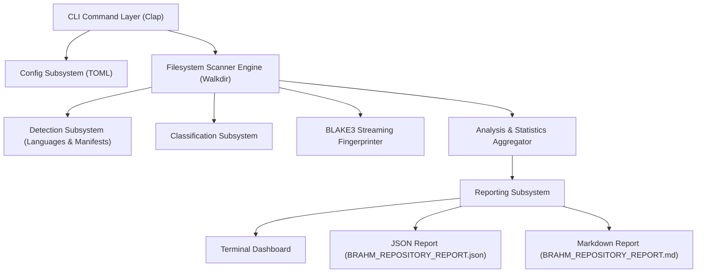

# BRAHM Architecture Specification — Stage 01

## 1. System Overview

BRAHM (Blind Reverse-engineering & Adversarial Honeypot Mechanism) is designed from first principles as an auditable, high-assurance security analysis system.

Stage 01 establishes the foundational **Repository Analyzer** module.

---

## 2. Component Subsystems

### 2.1 CLI Layer (`src/cli/`)
- Powered by `clap` v4 with derive macros.
- Provides strict argument parsing, type validation, and standardized Unix/Windows exit codes.
- Commands:
  - `init`: Deterministically creates `brahm.toml` without accidental overwrites.
  - `scan`: Executes repository intelligence collection with configurable format flags and exclusion overrides.

### 2.2 Configuration Subsystem (`src/config/`)
- Configured via `brahm.toml`.
- Strict boundary constraints:
  - `follow_symlinks`: Defaults to `false` for cybersecurity isolation.
  - `max_file_size_mb`: Upper bound checked to prevent memory exhaustion.
  - `exclusions`: Granular directory, filename, and extension blacklists.

### 2.3 Filesystem Scanner (`src/scanner/`)
- Memory-safe directory traversal utilizing streaming filesystem handles.
- Canonical path checks ensure symlinks cannot escape the designated repository root.
- Unreadable files or permission errors are logged as warnings and do not abort traversal.

### 2.4 Detection & Classification (`src/detection/`, `src/classification/`)
- Language detection by case-insensitive extension matching and specific filename mappings.
- Framework detection with evidence tracking and confidence levels:
  - `ConfirmedByManifest`
  - `StronglyIndicated`
  - `Possible`
  - `Unknown`
- Categorizes files into explicit roles (Source, Config, Tests, Assets, Database, Scripts, Infrastructure).

### 2.5 Analysis Engine (`src/analysis/`)
- Calculates file distributions, byte distributions, percentages, configuration counts, and warnings.
- Formats file sizes using standard binary/decimal human units.

### 2.6 Reporting Subsystem (`src/reporting/`)
- Generates reproducible, structured outputs:
  - Terminal view for interactive CLI usage.
  - Machine-readable JSON conforming to `v1.0` schema.
  - Comprehensive GitHub-flavored Markdown for executive and audit documentation.

---

## 3. Stage 02 Code Intelligence Pipeline Extension

Stage 02 adds deep deterministic static analysis on top of Stage 01's discovered files:

- Detailed technical design documents:
  - [`docs/STAGE_02.md`](STAGE_02.md) — Stage 02 Architecture Overview
  - [`docs/PARSER_ARCHITECTURE.md`](PARSER_ARCHITECTURE.md) — Tree-sitter AST Engine
  - [`docs/SYMBOL_EXTRACTION.md`](SYMBOL_EXTRACTION.md) — Multi-language Symbol Extraction & Indexing
  - [`docs/DEPENDENCY_ANALYSIS.md`](DEPENDENCY_ANALYSIS.md) — Import Resolution & Cycle Detection
  - [`docs/ARCHITECTURE_GRAPH.md`](ARCHITECTURE_GRAPH.md) — `petgraph` Topology & Blast Radius Engine
  - [`docs/LANGUAGE_SUPPORT.md`](LANGUAGE_SUPPORT.md) — Language, Framework, API & ORM Support Matrix

---

## 4. Reliability & Cybersecurity Guarantees
- **No Runtime AI Models:** Deterministic algorithms eliminate prompt injection risks and hallucinated structures.
- **Fail-Safe Defaults:** Symlinks are non-traversing by default; configuration files will not overwrite existing assets without `--force`.
- **Zero Secret Exposure:** Credentials, private keys, and `.env` values are excluded from report output.
