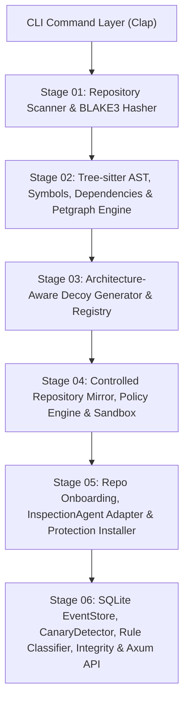

# BRAHM System Architecture Specification (Stages 01–06)

## 1. End-to-End Architecture

BRAHM (Blind Reverse-engineering & Adversarial Honeypot Mechanism) is a pure Rust deterministic cybersecurity framework structured as a six-stage modular pipeline:

---

## 2. Stage Subsystems & Specifications

- **Stage 01 — Repository Analyzer:** [`STAGE_01.md`](STAGE_01.md) — Recursive traversal (`src/scanner/`), language/framework detection (`src/detection/`), file classification (`src/classification/`), BLAKE3 hashing (`src/analysis/`).
- **Stage 02 — Code Intelligence & Architecture Mapping:** [`STAGE_02.md`](STAGE_02.md) — [`PARSER_ARCHITECTURE.md`](PARSER_ARCHITECTURE.md), [`SYMBOL_EXTRACTION.md`](SYMBOL_EXTRACTION.md), [`DEPENDENCY_ANALYSIS.md`](DEPENDENCY_ANALYSIS.md), [`ARCHITECTURE_GRAPH.md`](ARCHITECTURE_GRAPH.md), [`LANGUAGE_SUPPORT.md`](LANGUAGE_SUPPORT.md).
- **Stage 03 — Decoy Generation Engine:** [`STAGE_03_DECOY_ENGINE.md`](STAGE_03_DECOY_ENGINE.md).
- **Stage 04 — Repository Deception Engine:** [`STAGE_04_DECEPTION_ENGINE.md`](STAGE_04_DECEPTION_ENGINE.md).
- **Stage 05 — Agent Integration & Hybrid Protection:** [`STAGE_05_AGENT_INTEGRATION.md`](STAGE_05_AGENT_INTEGRATION.md).
- **Stage 06 — Monitoring & Intelligence Engine:** [`STAGE_06_MONITORING_ENGINE.md`](STAGE_06_MONITORING_ENGINE.md).

---

## 3. Cross-Cutting Reference Docs
- [`SECURITY_MODEL.md`](SECURITY_MODEL.md)
- [`DATA_MODELS.md`](DATA_MODELS.md)
- [`CLI_REFERENCE.md`](CLI_REFERENCE.md)
- [`CONFIGURATION.md`](CONFIGURATION.md)
- [`INSTALLATION.md`](INSTALLATION.md)
- [`TROUBLESHOOTING.md`](TROUBLESHOOTING.md)
