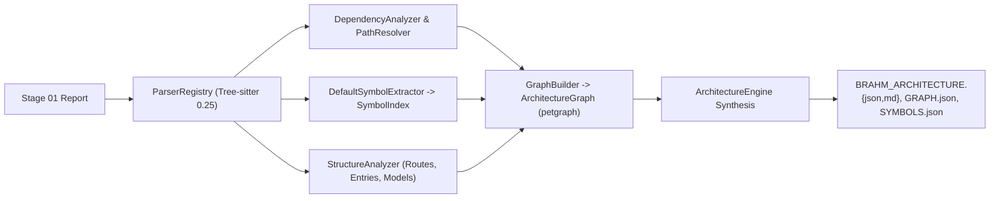

# BRAHM Stage 02 — Code Intelligence & Architecture Mapping Engine

## 1. Executive Summary

Stage 02 extends the **BRAHM (Blind Reverse-engineering & Adversarial Honeypot Mechanism)** Repository Analyzer with a deterministic, rule-based static code intelligence and architecture reconstruction engine written in pure Rust.

Operating **strictly without runtime AI models, LLMs, or external inference APIs**, Stage 02 transforms source trees into Concrete Syntax Trees (CST/AST), indexes software symbols with deterministic identifiers, resolves module dependencies and circular imports, locates application landmarks (entry points, API endpoints, database models), constructs a unified `petgraph` architectural dependency graph, and synthesizes actionable technical blueprints (`BRAHM_ARCHITECTURE.json`, `BRAHM_ARCHITECTURE.md`, `BRAHM_DEPENDENCY_GRAPH.json`, `BRAHM_SYMBOL_INDEX.json`).

---

## 2. Seven Milestones Completed

### Milestone 01 — Multi-Language Parser Foundation & Registry (`src/parser/`)
- Integrated `tree-sitter = "0.25"` with ABI version 15 support across 8 language grammars (`Rust`, `JavaScript`, `TypeScript`/`TSX`, `Python`, `Go`, `Java`, `C`, `C++`).
- Implemented `LanguageParser`, `TreeSitterEngine`, `ParserRegistry`, `ParsedSource`, `ParserConfig`, and `SourceSpan`.
- Built error-resilient parsing with bounded file-size limits, lossy UTF-8 handling, and multi-threaded safety.

### Milestone 02 — Symbol Extraction Engine & Index (`src/symbols/`)
- Extracted functions, methods, classes, interfaces, traits, structs, enums, and modules across all supported languages.
- Implemented deterministic 16-character BLAKE3-based symbol identifiers normalized across Windows/POSIX paths (`generate_symbol_id`).
- Built `SymbolIndex` with $O(1)$ lookup by ID, file path, kind, and unqualified name.

### Milestone 03 — Import, Export & Dependency Analysis (`src/dependencies/`)
- Extracted `use`, `import`, `require`, `from ... import`, Go imports, Java imports, and C/C++ `#include` statements plus exports across languages.
- Implemented `PathResolver` resolving relative paths, extension/index variants, and internal Rust `crate::`/`super::` modules vs. external packages.
- Built DFS `CycleDetector` with canonical rotation deduplication to report circular file dependencies.

### Milestone 04 — Application Structure & Landmark Detection (`src/structure/`)
- Implemented `EntryPointDetector` locating binary `main()` entry points, library roots (`lib.rs`, `index.ts`), and server entry scripts (`server.js`, `app.py`, `wsgi.py`).
- Implemented `ApiRouteDetector` extracting HTTP endpoints from Express/Fastify, Next.js (Pages & App Router), FastAPI/Flask, Gin/Echo, Actix-web/Axum, and Spring Boot annotations.
- Implemented `DataModelDetector` locating Django ORM, SQLAlchemy, TypeORM (`@Entity`), Prisma schemas, SQL migration files, and DDL table definitions.

### Milestone 05 — Architecture & Dependency Graph Engine (`src/graph/`)
- Built `ArchitectureGraph` backed by `petgraph::graph::DiGraph<GraphNode, GraphEdge>`.
- Connected files, modules, symbols, API routes, data models, and external packages via typed edges (`Contains`, `Imports`, `Calls`, `RoutesTo`, `InheritsFrom`, `DependsOn`).
- Implemented topological sorting, Tarjan strongly connected component (SCC) cycle detection, fan-in/fan-out centrality rankings, blast radius analysis, and JSON graph export (`GraphExport`).

### Milestone 06 — Architecture Intelligence & Reporting (`src/architecture/`, `src/reporting/`)
- Created `ArchitectureEngine` orchestrating the complete Stage 02 static analysis pipeline on top of Stage 01 output.
- Generated cross-platform normalized outputs separating **verified static facts**, **inferred architectural patterns/relationships**, and **unresolved references**.
- Integrated into CLI via `brahm scan <repo> --arch` (`--deep`) and `brahm arch <repo>`.
- Emits `BRAHM_ARCHITECTURE.json`, `BRAHM_ARCHITECTURE.md`, `BRAHM_DEPENDENCY_GRAPH.json`, and `BRAHM_SYMBOL_INDEX.json`.

### Milestone 07 — Testing, Accuracy Validation & Final Documentation
- Built Fixture D (`fixtures/fixture_d_mixed/`) combining Python FastAPI/SQLAlchemy, Rust workers, Go Gin, Java Spring Boot, TypeScript circular imports + TypeORM, C++ native code, intentional malformed syntax, and sensitive `.env` secrets.
- Verified symbol recall ($\ge 90\%$), multi-language route detection, circular dependency detection, strict read-only target preservation, secret masking, and deterministic reproducibility.

---

## 3. Pipeline Architecture Overview

