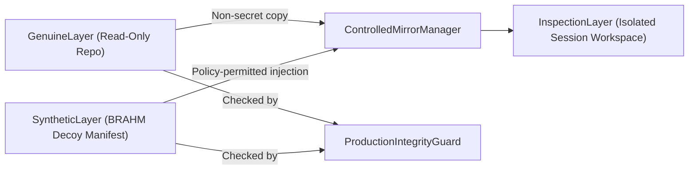

# BRAHM Stage 04 — Repository Deception Engine (`src/deception/`)

## 1. Objective

Connects Stage 03 generated decoys to strictly isolated inspection mirror workspaces, deterministic deception policies, session lifecycles, and production build exclusion guards.

BRAHM transparently recognizes that public Git hosts serve identical files to anonymous clones; controlled inspection views operate through isolated local mirrors and authorized sandbox environments.

---

## 2. Layer Separation (`src/deception/layers.rs`)

- **GenuineLayer:** Original repository baseline captured with BLAKE3 hashes.
- **SyntheticLayer:** Validated decoy staging layer & `BRAHM_DECOY_MANIFEST.json`.
- **InspectionLayer:** Isolated workspace per session with `.env`, `*.pem`, `*.key`, and `.git/` stripped prior to assembly.

---

## 3. Core Subsystems

- **Policy Engine (`src/deception/policy.rs`):** Evaluates candidate decoys under `Conservative`, `Standard`, or `Research` presets, enforcing `allow_secret_exposure == false` and `allow_production_deployment == false`. Produces auditable `PolicyDecision` logs.
- **Mirror Manager (`src/deception/mirror.rs`):** Prevents workspace overlap inside genuine repositories, rejects path traversals, computes baseline and inspection-view BLAKE3 hashes, and isolates colliding decoy paths under `_synthetic_overlay/`.
- **Session Manager (`src/deception/session.rs`):** Enforces session states (`Created -> Prepared -> Active -> Suspended -> Completed / Expired -> Cleaned`), UUID session directories for concurrency isolation, and TTL expiration checks.
- **Production Integrity Guard (`src/deception/layers.rs`):** Scans genuine source trees and production build manifests (`Cargo.toml`, `package.json`, etc.) for synthetic markers (`BRAHM-SYNTHETIC-ARTIFACT`, `BRAHM-CANARY-`) and blocks mirror preparation if contamination is found.
- **Inspection Sandbox (`src/deception/sandbox.rs`):** `ControlledInspectionEnvironment` enforces canonical workspace confinement, blocks `..` escapes, sets `outbound_network_allowed = false`, and emits `WorkspaceAccessRecord` events.

---

## 4. Stage 04 Deliverables

Generated per inspection session inside `<sessions_root>/<session_id>/`:
- `BRAHM_DECEPTION_POLICY.json`
- `BRAHM_INSPECTION_MANIFEST.json`
- `BRAHM_SESSION_REPORT.json`
- `BRAHM_INTEGRITY_REPORT.json`
