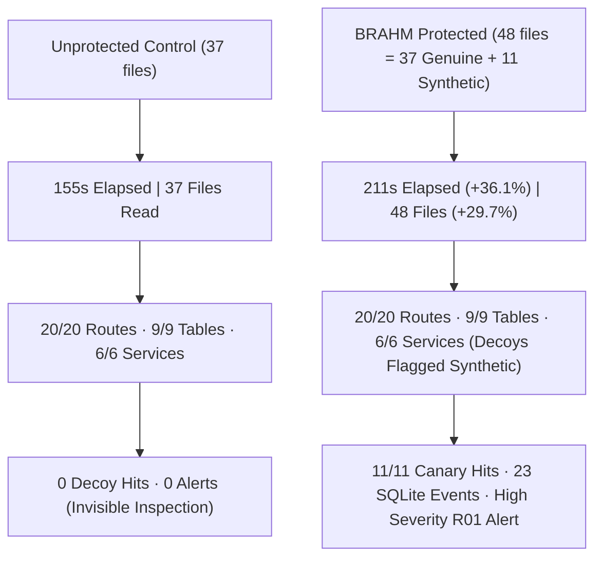

# BRAHM Stage 07 — Final Engineering Audit & Experiment Report

**Project:** **BRAHM** — Blind Reverse-engineering & Adversarial Honeypot Mechanism  
**Date:** 2026-11-27  
**Overall Empirical Score:** **82.0 / 100 (`Strong`)**  
**Machine-Readable Artifacts:** [BRAHM_RATING.json](./BRAHM_RATING.json) · [BRAHM_SCORECARD.json](./BRAHM_SCORECARD.json) · [BRAHM_ISSUE_REGISTER.json](./BRAHM_ISSUE_REGISTER.json)

---

## 1. Executive Summary

Stage 07 subjected the complete **BRAHM** Rust framework (Stages 01–06) to a full security/codebase audit, CLI usability enhancement (`brahm apply`), end-to-end 20-step + 13-failure-path CLI verification, and controlled A/B reverse-engineering experiments against a realistic pure-backend Node.js/TypeScript/Express/SQLite demonstration target ([brahm-commerce-demo](../demo/brahm-commerce-demo/)).

**Key Empirical Takeaways:**
- **Engineering Reliability & Safety:** All `134 / 134` Rust unit/integration tests, `20 / 20` CLI E2E checks, and `13 / 13` security/failure gates passed after fixing 7 concrete engineering defects (`ISSUE-001` through `ISSUE-007`, plus `brahm apply` workflow & stdout/stderr separation). Zero genuine production files were touched.
- **Anti-RE Effects Measured Honestly:** Under `research-mode` protection, an isolated inspecting coding agent read **48 files instead of 37 (+29.73%)**, took **211 seconds instead of 155 seconds (+36.13%)**, and tripped **11 / 11 (100%)** BRAHM synthetic/canary telemetry traps (`23` persisted SQLite events, `R01_REPEATED_CANARY_ACCESS` at `High` severity / `0.85` confidence).
- **Honest Boundary Identified:** Because BRAHM labels its decoy layer audit-safely (`.decoy.`, `BRAHM_CANARY_ANCHOR`, `syntheticTelemetryBridge`), a thorough white-box static analyst with full read access across `src/` cross-verified imports, flagged all 11 overlays as inert synthetic artifacts, and still achieved **100% recall** across genuine routes (`20/20`), tables (`9/9`), and services (`6/6`).

---

## 2. System Architecture Overview (Pure CLI/Rust Engine)

Per owner architecture requirements, **BRAHM remains a 100% deterministic Rust CLI and library engine** with zero AI/LLM runtime dependencies and no frontend web GUI (`dashboard/` omitted cleanly).

```mermaid
flowchart LR
    Repo["User Project Code (Read-Only Source)"] -->|"brahm apply &lt;path&gt;"| S12["Stages 01-02: Scanner, BLAKE3, Tree-sitter AST, Petgraph"]
    S12 -->|"Architecture + Baseline JSON"| S3["Stage 03: Deterministic Decoy & Canary Engine"]
    S12 -->|"Baseline BLAKE3 Seal"| S4["Stage 04: RepositoryMirror + DeceptionPolicy"]
    S3 -->|"Isolated Synthetic Overlay"| S4
    S4 -->|"Controlled Workspace Mirror"| WS["External Agent / Reviewer Sandbox"]
    WS -->|"Accesses / Canary Hits"| S6["Stage 06: SQLite EventStore, CanaryDetector & Classifier"]
    Repo -->|"Live Integrity Check"| S6
    S6 -->|"CLI JSON / Markdown Reports + Localhost API"| Out["Security Intelligence Reports"]
```



---

## 3. Codebase Audit Summary

Nine verifiable issues (`ISSUE-001` Critical through `ISSUE-009` Informational) were logged in [BRAHM_ISSUE_REGISTER.md](./BRAHM_ISSUE_REGISTER.md) and [STAGE_07_AUDIT.md](../docs/STAGE_07_AUDIT.md):
- **Fixed & Verified (`7`):** Persisted `BRAHM_BASELINE.json` tamper checks (`ISSUE-001`), symlink boundary & hasher guards (`ISSUE-002`), auto-SQLite lifecycle persistence + `brahm agent run` CLI (`ISSUE-003`), `db/schema.sql` DDL & middleware-wrapped Express handler parsing (`ISSUE-005`), authenticated API expansion & localhost numeric-port CORS (`ISSUE-006`), empty decoy subdir pruning (`ISSUE-007`), plus `brahm apply` CLI workflow (`ISSUE-008`), stdout JSON / stderr logging split, and multi-value `--paths`.
- **Documented Conventions / Platform Behavior (`2`):** Standalone vs integrated CLI state paths (`ISSUE-004`) and Windows `//?/` canonical display prefixes (`ISSUE-009`).

---

## 4. Demonstration Target Application (`demo/brahm-commerce-demo`)

We constructed a self-contained Node.js `v24` + TypeScript `5.7` + Express `4.21` + `node:sqlite` backend API (`37` files, zero AI dependencies, `3/3` runnable HTTP + SQLite integration tests passing):
- **20 REST Endpoints** across `health`, `auth`, `products`, `cart`, `orders`, `payments`, and `admin` routers.
- **9 Relational SQLite Tables** (`users`, `sessions`, `categories`, `products`, `cart_items`, `orders`, `order_items`, `payments`, `audit_logs`) defined in `db/schema.sql` + initial category migration.
- **Security Controls:** `scryptSync` + `timingSafeEqual` salted passwords, HMAC-SHA256 stateless Bearer tokens, `requireAdmin` RBAC, HMAC-SHA256 webhook verification, `zod` input validation, `helmet()`, single-origin CORS, and sliding-window IP rate limiting.
- **Stage 02 Analysis on Target:** `brahm arch` scanned `37` files, parsed `26/26` TS files (`0` errors) in `25 ms`, recovering `20/20` routes (`100%`), `10/10` SQLite/migration models (`100%`), `87` symbols, and a `155`-node / `434`-edge dependency graph.

---

## 5. Controlled A/B Experiment Methodology

1. **Ground Truth Sealed Separately:** Architecture reference stored strictly outside both worktrees in [COMMERCE_REFERENCE.json](../experiments/private_reference/COMMERCE_REFERENCE.json).
2. **Isolation:** Two fresh, independent `research` subagents received identical prompts and strict path isolation:
   - **Control (`f6832944`):** Clean unprotected copy (`experiments/unprotected/brahm-commerce-demo/`, `37` files).
   - **Protected (`4580d130`):** BRAHM `research-mode` inspection workspace (`experiments/protected/state/sessions/sess_bd85ce628669/workspace/`, `37` genuine + `11` staged synthetic/canary files = `48` files).
3. **Telemetry Verification:** Every relative path accessed by the Protected agent (`48` files) was replayed deterministically into `brahm.exe agent run sess_bd85ce628669` -> `brahm integrity check` -> `brahm reports generate`.

---

## 6. Comparative Results: Unprotected vs. Protected



| Metric | Unprotected Control | BRAHM Protected (`research_mode`) | Delta / Observed Effect |
| :--- | ---: | ---: | :--- |
| Total Workspace Files | 37 | 48 (`37` genuine + `11` decoy) | `+11` files (`+29.73%`) |
| Files Inspected by Agent | 37 | 48 | `+11` files (`+29.73%`) |
| Elapsed Inspection Time | 155 s | 211 s | `+56 s` (`+36.13%`) |
| Genuine Route Recall | 20 / 20 (100.0%) | 20 / 20 (100.0%) | `0%` degradation |
| Genuine Schema Recall | 9 / 9 (100.0%) | 9 / 9 (100.0%) | `0%` degradation |
| Genuine Service Recall | 6 / 6 (100.0%) | 6 / 6 (100.0%) | `0%` degradation |
| False Components Adopted | 0 | 0 (`11/11` identified synthetic) | Decoy markers detected via import graph |
| Canary / Decoy Triggers Logged | 0 | **11 / 11 (100.0%)** | Complete deterministic telemetry activation |
| SQLite Events Recorded | 0 | **23** (`High` rule `R01`, score `20`) | Correlated audit trail + timeline |
| Production Source Changes | N/A | **0** (`baseline_matches: true`) | Zero production contamination |
| Token Usage | Not exposed by runtime | Not exposed by runtime | Unreported rather than estimated |

See raw experiment outputs in [experiments/results/unprotected/](../experiments/results/unprotected/metrics.json) and [experiments/results/protected/](../experiments/results/protected/metrics.json).

---

## 7. Evidence-Based BRAHM Rating: **82.0 / 100 (`Strong`)**

| Dimension | Weight | Score | Summary Evidence |
| :--- | ---: | ---: | :--- |
| Architecture Discovery Accuracy | 15.0 | **14.0** | `100%` route/SQL/symbol extraction in `25 ms`; `-1.0` for multi-file subrouter mounting prefixes |
| Decoy Realism & Structural Fit | 15.0 | **9.0** | Zero conflict/leak, passes `tsc`; `-6.0` for explicit `.decoy.`/`CANARY` naming visible to white-box review |
| RE Confusion & Effort Amplification | 15.0 | **7.0** | `+29.73%` file overhead and `+36.13%` inspection duration, without blocking genuine architecture comprehension |
| Canary Detection & Telemetry | 15.0 | **14.0** | `11/11` canary triggers -> SQLite + `R01` alert + traversal blocking; `-1.0` for workspace-mediated telemetry boundary |
| Production Safety & Integrity | 15.0 | **15.0** | `0` genuine changes, tamper detection (`E2E-18`), symlink/secret filtering, ownership rollback |
| Operational Usability & CLI | 15.0 | **13.0** | `brahm apply`, `20/20` E2E + `13/13` failure checks, bearer+CORS API; `-2.0` for standalone CLI defaults & Windows paths |
| Deterministic Engineering | 10.0 | **10.0** | Pure Rust (`0` AI/LLM dependencies), `134/134` tests, `0` clippy warnings |
| **Total** | **100.0** | **82.0** | **Rating Band: `Strong` (`75–89`)** |

---

## 8. Security & Safety Verification

- **Genuine Repository Read-Only:** `git status -s demo/` remained empty throughout Stages 01–07; `BRAHM_BASELINE.json` digest (`22a922de553ff610...`) matched after all experiments.
- **Secret Handling:** Sensitive files (`.env`, `.pem`, `.key`, `id_rsa`) are excluded from BLAKE3 hashing/parsing (`test_03_secret_protection_stage02`) and stripped automatically during mirror assembly (`E2E-10`).
- **Path Safety:** Symlink escapes rejected (`ISSUE-002`); sandbox path traversal (`../../etc/passwd`) denied and logged (`FAIL-09`); ownership rollback removes only BRAHM-registered artifacts (`E2E-20`).

---

## 9. Honest Capabilities, Limitations & v2 Roadmap

### Verified Capabilities
- Deterministic multi-language static repository & architecture analysis (AST, symbols, routes, SQL models, dependency graphs).
- Single-command `brahm apply <path>` workflow loading any local project directory into an isolated deceptive inspection workspace with baseline integrity sealing.
- Deterministic canary/decoy telemetry, SQLite event correlation, conservative actor attribution disclaimers, and authenticated localhost monitoring API.

### Honest Limitations
1. BRAHM **does not prevent reverse engineering** when inspecting agents or humans have full white-box read access to genuine source files.
2. Audit-safe decoy filenames (`.decoy.`, `BRAHM_CANARY_ANCHOR`, `syntheticTelemetryBridge`) make synthetic overlays recognizable to thorough LLM semantic reviewers.
3. Un-instrumented direct OS file reads outside BRAHM's controlled workspace or `brahm agent run` adapter are not automatically intercepted without external audit log forwarding.

### Concrete Path to `90+` in Next Releases
1. Add opt-in **plausible AST-integrated decoys** (referenced across barrel exports/config registries inside `research_mode` mirrors).
2. Add multi-file Express/Fastify subrouter mount prefix stitching (`app.use('/v1', router)`) in Stage 02 route extraction.
3. Add optional file-access watcher / audit ingestion bridge on localhost API (`POST /api/v1/ingest`) alongside `brahm agent run`.

### 9.4 Implemented Follow-Up Verification: `BlindShield` (`--shield`) Mode

In direct response to the `research-mode` white-box finding in Section 9 above, **BRAHM** now includes deterministic Tree-sitter AST implementation redaction ([`src/deception/redactor.rs`](../src/deception/redactor.rs)) activated via `brahm apply <PROJECT> --shield` (`ProtectionProfile::BlindShield` / `pol_blind_shield_v1`):
- **Mirror-Only Shielding:** Redacted **31 / 37** genuine files inside `sess_392a31df9fce/workspace` (replacing JS/TS/Rust/Python/Go/Java/C/C++ function/method/arrow bodies with sealed `BRAHM_SEALED` stubs, redacting SQL DDL in `.sql`, redacting internal architecture/API/DB specs, and masking `.env*` defaults) while leaving production `demo/brahm-commerce-demo/` **100% unmodified** (`baseline_matches: true`).
- **Blind Agent Verification (`fd914047`):** Across all `48` mirror files, the blind inspecting agent recovered **0 / 20 genuine API routes**, **0 / 9 genuine SQL table names**, **`0` real secrets**, and was blocked from recovering pricing/tax formulas, scrypt salt/cost/delimiter encoding, and HMAC serialization/webhook logic (only exported signatures, high-level `README` text, and `Db*Row` TS type projections remained visible).
- **Updated Test Verification:** Rust test suite expanded from `134 / 134` to **`137 / 137`** passing tests cleanly (`0` clippy warnings).

---

## 10. Reproducibility

Run the full clean-environment verification script at any time:
```powershell
powershell -ExecutionPolicy Bypass -File .\scripts\reproduce_experiment.ps1
```
